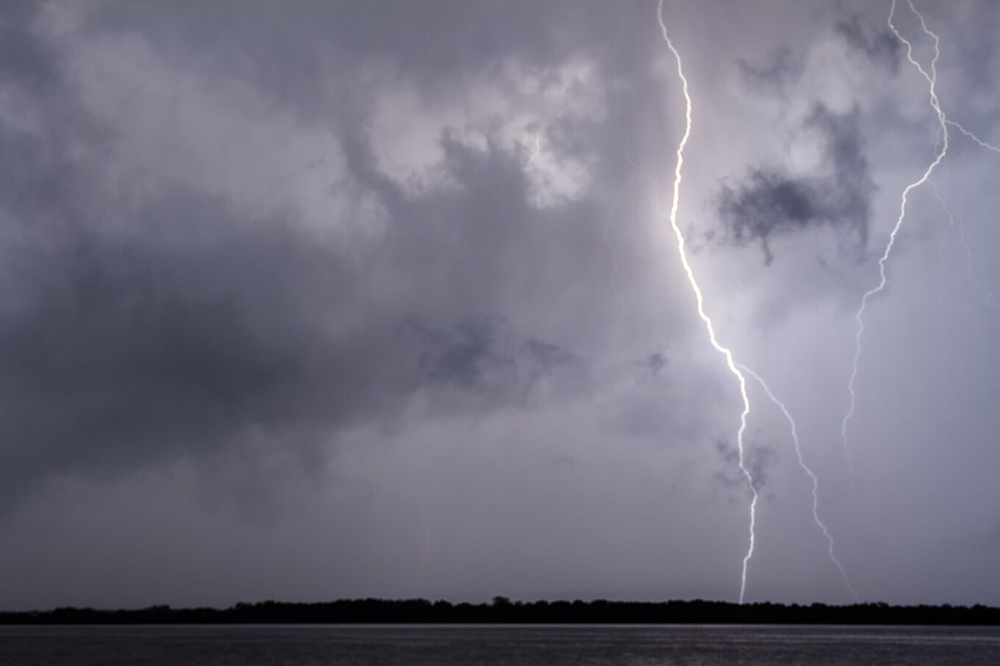
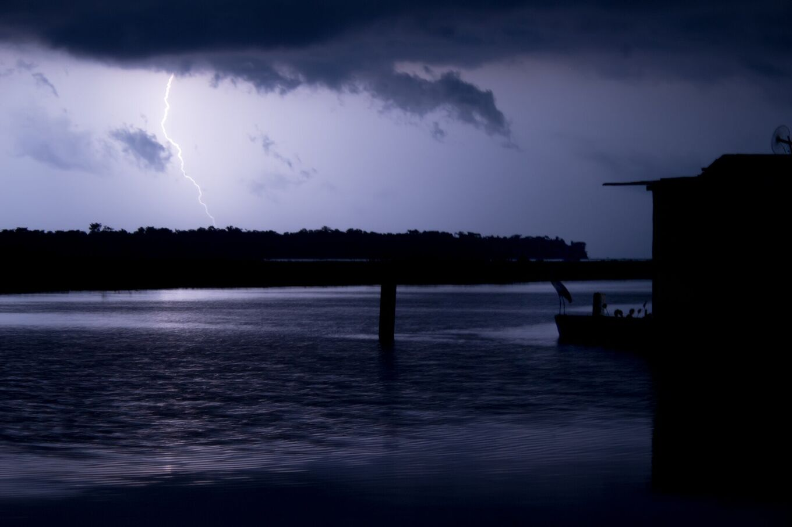
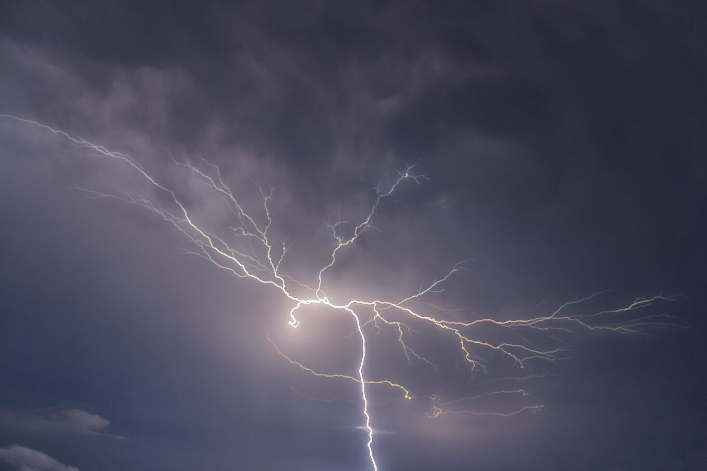

## Un temporale che torna quasi ogni notte.

Il fulmine del Catatumbo (Relámpago del Catatumbo) è un temporale che si forma di notte sopra il sud-ovest del lago di Maracaibo e le paludi vicine alla foce del río Catatumbo. Dalla riva sembra un bagliore quasi continuo tra le nuvole, spesso senza tuono udibile perché il temporale è lontano.

Non è uno spettacolo in programma: ogni notte è diversa. Alcune notti portano centinaia di lampi, altre sono calme. L’attività dipende dal vento, dall’umidità e dalla stagione.

*[Fernando Flores · Wikimedia Commons · CC BY-SA 2.0](https://commons.wikimedia.org/wiki/File:Catatumbo_Lightning_-_Rayo_del_Catatumbo_%2825385580334%29.jpg)*

| Cifra | Che cosa significa |
| --- | --- |
| 140–160 | Notti con attività all’anno |
| 16–40 | Lampi al minuto |
| ≈ 9 h | Durata tipica per notte |
| 12–15 km | Altezza raggiunta dalle nubi temporalesche |
| 232,5 | Lampi per km² all’anno (NASA LIS, 2016) |

## Molti temporali, un solo nome.

I ricercatori dell’Università dello Zulia preferiscono parlare *dei* fulmini del Catatumbo: ogni notte si formano diverse celle temporalesche in punti diversi del delta e del sud-ovest del lago. Da lontano si fondono in un unico bagliore.

Le nubi sono cumulonembi, le nubi temporalesche più alte, che salgono fino al tetto della troposfera tropicale. La maggior parte dei lampi resta dentro le nubi o passa dall’una all’altra e le illumina dall’interno. Altri colpiscono il suolo o l’acqua.

La luce arriva molto più lontano del suono. Il tuono si sente raramente oltre i 20 km circa, mentre il bagliore si vede da molto più lontano. Per questo, da Maracaibo o dalla riva, il fulmine sembra muto. Sotto il temporale il tuono è quasi continuo.

*[Fernando Flores · Wikimedia Commons · CC BY 3.0](https://commons.wikimedia.org/wiki/File:Catatumbo_Lightning_%28127737829%29.jpeg)*

## Come si forma.

### L’umidità

Il lago è caldo ed evapora molta acqua. Gli alisei dei Caraibi spingono quell’aria umida verso il sud del bacino.

### Il rilievo

Il bacino è chiuso dalla Sierra de Perijá a ovest e dalla cordigliera di Mérida a sud-est. L’aria resta chiusa tra montagne di oltre 3.000 m.

### La convergenza notturna

Di notte, l’aria fresca che scende dalle montagne incontra l’aria calda del lago. Quel flusso costringe l’aria umida a salire e forma nubi temporalesche quasi sempre nello stesso punto.

### Il vento della notte

Una corrente di vento, il getto notturno di bassa quota del lago di Maracaibo, attraversa il bacino di notte. Quando soffia forte e l’aria contiene molta energia temporalesca (quella che i meteorologi chiamano CAPE), ci sono più fulmini. Nel 2016 un gruppo dell’Università dello Zulia ha usato questo legame per pubblicare la prima previsione stagionale dei fulmini al mondo, con mesi di anticipo.

> Per anni si è pensato che la causa fosse il metano delle paludi e dei giacimenti di petrolio. Gli studi recenti la attribuiscono soprattutto al vento e al rilievo; il ruolo del metano è ancora discusso.

Il modello del metano fallisce anche una prova semplice: prevede più fulmini nella stagione secca, e i dati mostrano il contrario.

## L’anno del fulmine.

Da settembre a novembre sono di solito i mesi più attivi; gennaio e febbraio i più tranquilli. È solo una tendenza: nel 2010 una siccità ha spento il fulmine da gennaio a marzo.

Il ritmo segue le piogge. La fascia delle piogge tropicali si sposta a nord e a sud durante l’anno e porta due stagioni più umide: una prima ad aprile e maggio, e una più forte nella seconda metà dell’anno, con il picco tra settembre e ottobre. Fenomeni climatici come El Niño la spostano da un anno all’altro: il silenzio del 2010 è arrivato durante una siccità legata a El Niño.

Nel corso di una notte, l’attività di solito comincia al tramonto, cresce dopo il buio ed è più forte verso mezzanotte e nelle prime ore del mattino. Nei mesi più secchi può presentarsi come temporale secco, senza pioggia.

*[Fernando Flores · Wikimedia Commons · CC BY-SA 2.0](https://commons.wikimedia.org/wiki/File:Catatumbo_Lightning_-_Rayo_del_Catatumbo_%2822668686290%29.jpg)*

## Che cosa non è.

### «Rigenera lo strato di ozono»

Falso. I fulmini producono ozono nella bassa atmosfera, la troposfera. Lo strato di ozono si trova nella stratosfera, a circa 25 km di altezza sopra i tropici. L’ozono del temporale si disperde e non lo ripara. Nessuno studio sostiene questa idea.

### «È un fulmine silenzioso»

Non lo è. Il tuono c’è; solo che non arriva a chi guarda da decine di chilometri.

### «Lo causa l’uranio del sottosuolo»

Un’ipotesi degli anni Novanta mai dimostrata.
