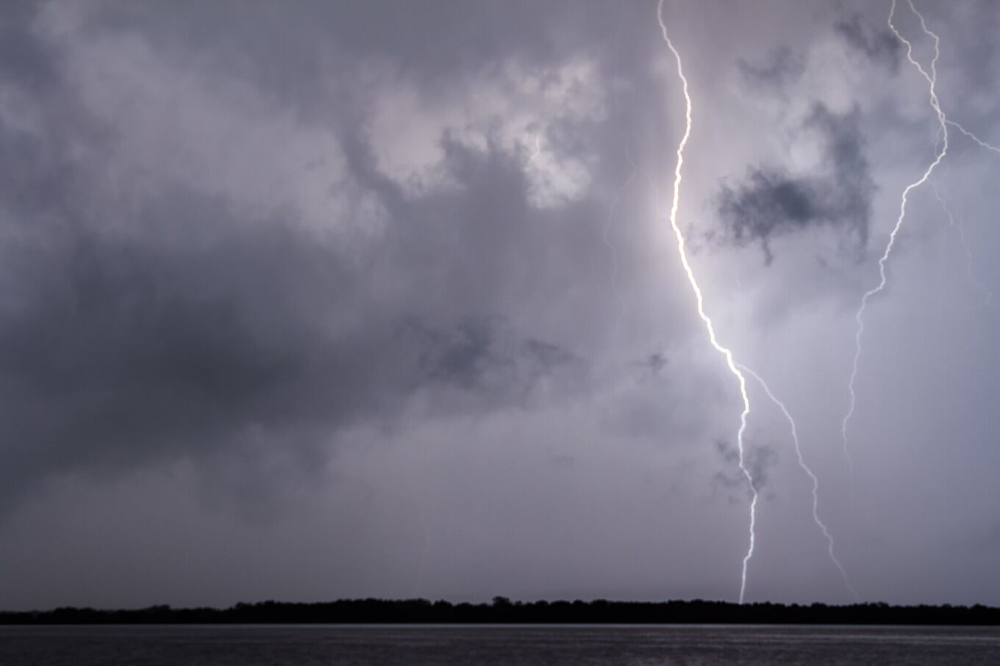
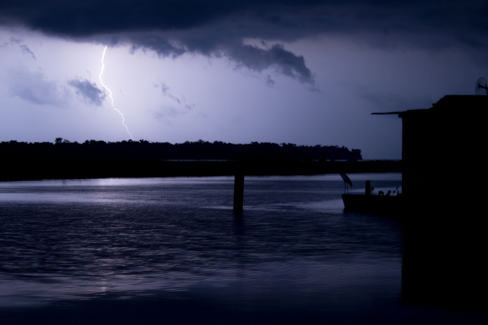

## Un temporale che torna quasi ogni notte

Il fulmine del Catatumbo (Relámpago del Catatumbo) è un temporale che si forma di notte sopra il sud-ovest del lago di Maracaibo e le paludi vicine alla foce del río Catatumbo. Dalla riva sembra un bagliore quasi continuo tra le nuvole, spesso senza tuono udibile perché il temporale è lontano.

Ogni notte è diversa. Alcune notti sono molto attive, altre calme. L'attività dipende dal vento, dall'umidità e dalla stagione.

*[Fernando Flores · Wikimedia Commons · CC BY-SA 2.0](https://commons.wikimedia.org/wiki/File:Catatumbo_Lightning_-_Rayo_del_Catatumbo_%2825385580334%29.jpg)*

| Cifra | Che cosa significa |
| --- | --- |
| 140–160 | Notti con attività all'anno |
| 16–40 | Lampi al minuto |
| ≈ 9 h | Durata tipica per notte |
| 12–15 km | Altezza raggiunta dalle nubi temporalesche |
| 232,5 | Lampi per km² all'anno (NASA LIS, 2016) |

## Molti temporali, un solo nome

I ricercatori dell'Università dello Zulia preferiscono parlare *dei* fulmini del Catatumbo, perché ogni notte si formano diverse celle temporalesche in punti diversi del delta e del sud-ovest del lago. Da lontano si fondono in un unico bagliore.

Le nubi sono cumulonembi, le nubi temporalesche più alte, che salgono fino al tetto della troposfera tropicale. La maggior parte dei lampi resta dentro le nubi o passa dall'una all'altra e le illumina dall'interno. Altri colpiscono il suolo o l'acqua.

La luce arriva molto più lontano del suono. Il tuono si sente raramente oltre i 20 km circa, mentre il bagliore si vede da molto più lontano. Per questo, da Maracaibo o dalla riva, il fulmine sembra muto. Sotto il temporale il tuono è quasi continuo.

*[Fernando Flores · Wikimedia Commons · CC BY 3.0](https://commons.wikimedia.org/wiki/File:Catatumbo_Lightning_%28127737829%29.jpeg)*

## Come si forma

### L'umidità

Il lago è caldo ed evapora molta acqua. Gli alisei dei Caraibi spingono quell'aria umida verso il sud del bacino.

### Il rilievo

Il bacino è chiuso dalla Sierra de Perijá a ovest e dalla cordigliera di Mérida a sud-est. L'aria resta chiusa tra montagne di oltre 3.000 m.

### La convergenza notturna

Di notte, l'aria fresca che scende dalle montagne incontra l'aria calda del lago. Quel flusso costringe l'aria umida a salire e forma nubi temporalesche quasi sempre nello stesso punto.

### Il vento della notte

Una corrente, il getto notturno di bassa quota del lago di Maracaibo, attraversa il bacino di notte. Quando soffia forte e l'aria contiene molta energia temporalesca (quella che i meteorologi chiamano CAPE), ci sono più fulmini. Nel 2016 un gruppo dell'Università dello Zulia ha usato questo legame per pubblicare la prima previsione stagionale dei fulmini al mondo, con mesi di anticipo.

> Per anni si è pensato che la causa fosse il metano delle paludi e dei giacimenti di petrolio. Gli studi recenti la attribuiscono soprattutto al vento e al rilievo; il ruolo del metano è ancora discusso.

Il modello del metano fallisce anche una prova semplice. Prevede più fulmini nella stagione secca, e i dati mostrano il contrario.

## Fonti e approfondimenti

- [Albrecht et al. · BAMS 2016](https://doi.org/10.1175/BAMS-D-14-00193.1)
- [Muñoz et al. · Atmospheric Research 2016 · previsione stagionale dei fulmini](https://doi.org/10.1016/j.atmosres.2015.12.018)
- [Wikipedia · Relámpago del Catatumbo (spagnolo)](https://es.wikipedia.org/wiki/Rel%C3%A1mpago_del_Catatumbo)
- [Wikipedia · Lago di Maracaibo](https://it.wikipedia.org/wiki/Lago_di_Maracaibo)
- [Wikipedia · Congo Mirador (spagnolo)](https://es.wikipedia.org/wiki/Congo_Mirador)
- [Blitzortung · fulmini in tempo reale](https://www.blitzortung.org/)
- [NASA Earthdata · The Maracaibo Beacon](https://www.earthdata.nasa.gov/news/feature-articles/maracaibo-beacon)
- [Video · ScienceABC · What Is The Beacon Of Maracaibo? (in inglese)](https://www.youtube.com/watch?v=iPw2KFU2raw)
