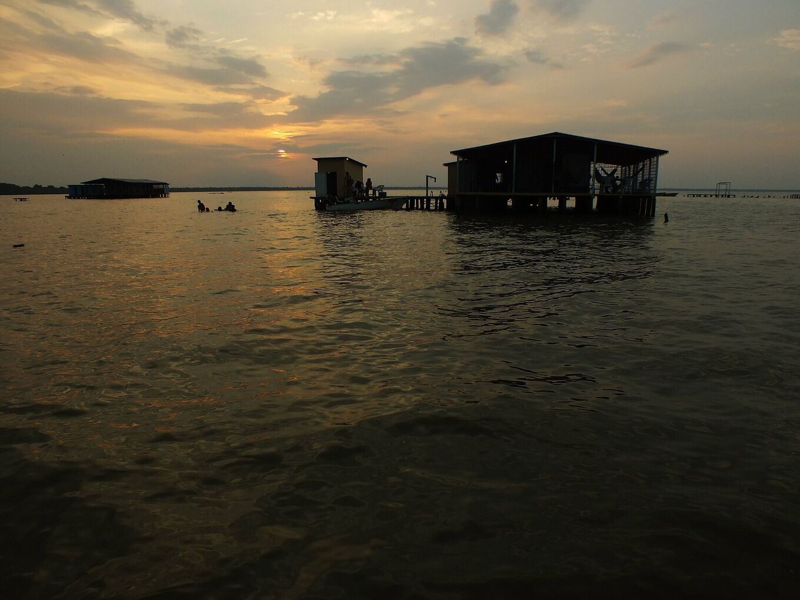
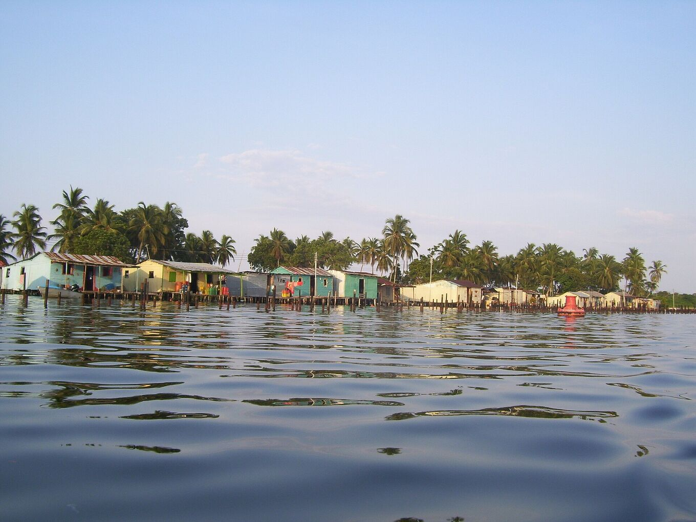
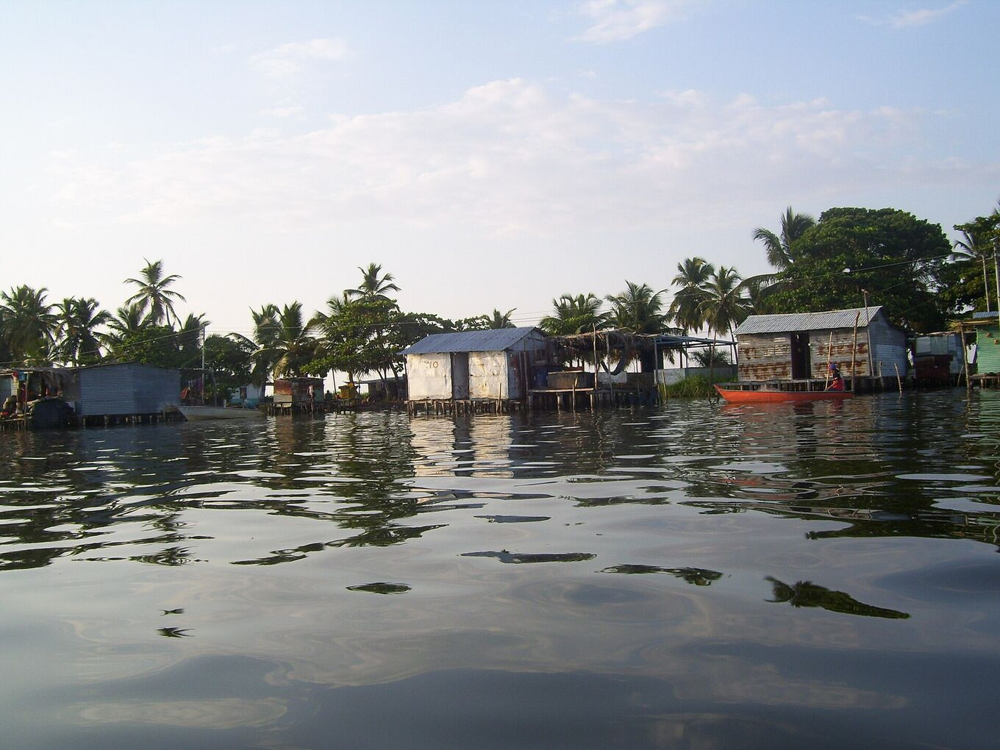
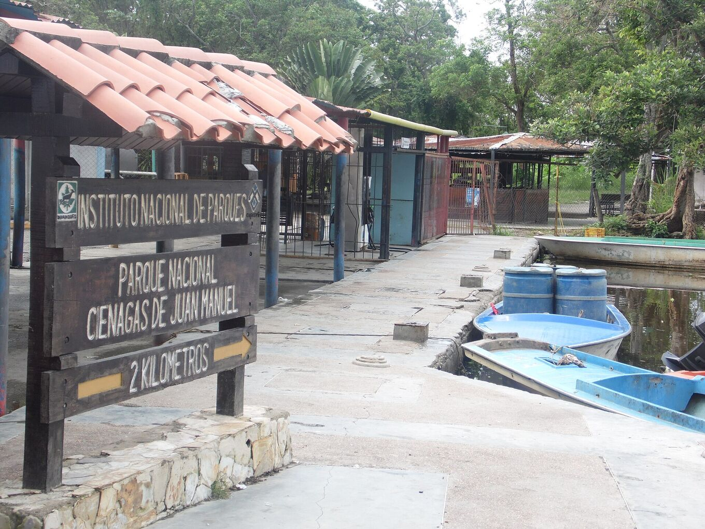

## Un lago, molte rive.

I luoghi istituzionali e comunitari che danno forma a una visita: l’area protetta dove nasce il temporale, i villaggi su palafitte da cui lo si osserva e l’imbarcadero da cui partono le barche.

Il lago di Maracaibo copre circa 13.500 km². A nord comunica con il mar dei Caraibi attraverso uno stretto, a sud lo alimentano decine di fiumi. Il più grande, il Catatumbo, porta più della metà della sua acqua.

## Il sud del lago

### Parco nazionale Ciénagas de Juan Manuel

*Area protetta · Inparques*

Zone umide, mangrovie e canali nel delta del Catatumbo, a sud-ovest del lago. È qui che si forma il temporale. È gestito dall’Istituto nazionale dei parchi (Inparques); le visite si fanno con guide autorizzate. [Wikipedia](https://es.wikipedia.org/wiki/Parque_nacional_Ci%C3%A9nagas_de_Juan_Manuel)

Si chiama anche Ciénagas del Catatumbo, o Aguas Blancas e Aguas Negras. Una pianura piatta e allagata tra la Sierra de Perijá e il lago, con temperature di 22–32 °C e un’umidità molto alta. Gli uccelli sono ovunque: aironi bianchi maggiori, aironi azzurri minori, jabirù, anatre, gabbiani, sterne e caracara.

*[Juan Pablo Bottaro · Wikimedia Commons · CC BY-SA 4.0](https://commons.wikimedia.org/wiki/File:Lago_en_llamas.jpg)*

### Ologá

*Comunità del lago · palafitte*

Villaggio su palafitte a una decina di minuti di barca da Congo Mirador. Oggi è la base principale per osservare il fulmine, con campi e pensioni semplici sopra l’acqua.

Alcune delle sue case vengono da Congo Mirador: poggiate su pali, si potevano caricare su due barche e spostare fin qui.

*[Yinette Bracho Padilla · Wikimedia Commons · CC BY-SA 4.0](https://commons.wikimedia.org/wiki/File:Palafitos_del_pueblo_de_Olog%C3%A1.jpg)*

### Congo Mirador

*Comunità del lago · palafitte*

Era il villaggio più noto per vedere il fulmine. L’interramento del lago e la crisi economica lo hanno svuotato: verso il 2018 se n’era andato circa il 90 % degli abitanti e molte case erano state spostate a Ologá. [Wikipedia](https://es.wikipedia.org/wiki/Congo_Mirador)

Il villaggio ha almeno 200 anni e viveva di pesca e, più tardi, di visitatori. Alla fine degli anni Settanta contava circa 930 abitanti, e circa mille nel 2013. Gli abitanti attribuiscono l’interramento a un canale di tre chilometri aperto dal río Bravo nel 1991, il «Caño J». Nel 2021 restavano circa cinque persone. La sua storia è raccontata nel documentario *Once Upon a Time in Venezuela* (2020), di Anabel Rodríguez Ríos.

*[Yinette Bracho Padilla · Wikimedia Commons · CC BY-SA 4.0](https://commons.wikimedia.org/wiki/File:Palafitos_de_Congo_Mirador.jpg)*

### Puerto Concha

*Imbarcadero · punto di partenza*

Imbarcadero vicino a Santa Bárbara del Zulia, da cui partono le barche per Ologá e il delta. Ci si arriva in auto dall’aeroporto di El Vigía.

Santa Bárbara è la città dell’allevamento del sud del lago, nota per il formaggio e i platani. Fai lì scorta di contanti, acqua e provviste: sull’acqua non ci sono negozi.

*[Yoser Linares · Wikimedia Commons · CC BY-SA 4.0](https://commons.wikimedia.org/wiki/File:Puerto_Concha.jpg)*
