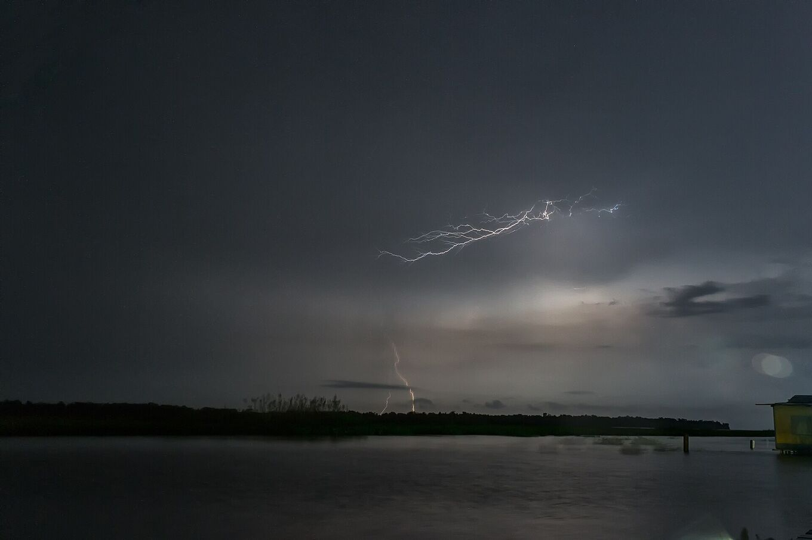

## Come leggere le previsioni.

- **Temporale** è una stima, non una previsione dei fulmini: nessuno può sapere quanti fulmini ci saranno. *Probabile* significa che il modello prevede un temporale durante la notte, oppure molta energia temporalesca con pioggia probabile. *Possibile*, energia moderata e un po’ di pioggia.
- **Pioggia** è la probabilità più alta tra le 18:00 e le 06:00.
- **Vento** è il vento medio più forte della notte. Con il vento il lago si increspa e il tragitto in barca è meno comodo.
- Tutti gli orari sono del Venezuela (UTC−4).

Anche quando le previsioni dicono *poco probabile*, il fulmine può comparire: si forma sopra il lago con le brezze della notte, e i modelli meteo vedono male una zona così piccola. Chiedi conferma alla tua guida il pomeriggio dell’escursione.

### Che cosa vuol dire «energia temporalesca»

I meteorologi la chiamano CAPE: l’energia che può guadagnare una bolla d’aria calda e umida salendo. Più ce n’è, più le nubi possono crescere in altezza, e sono le nubi alte a produrre i fulmini. Al Catatumbo, il CAPE insieme al vento notturno del lago è l’indizio migliore di quanto sarà attiva una notte.

*[Fernando Flores · Wikimedia Commons · CC BY-SA 2.0](https://commons.wikimedia.org/wiki/File:Catatumbo_Lightning-_Rayo_del_Catatumbo_%2828619470016%29.jpg)*

### Fulmini in tempo reale

Le previsioni dicono che cosa può succedere. Per vedere che cosa sta succedendo, reti di volontari come [Blitzortung](https://www.blitzortung.org/) mostrano i fulmini su una mappa in tempo reale. Sul Venezuela la copertura è più scarsa che in Europa e alcuni lampi non vengono rilevati.

### Offline

La pagina salva sul tuo telefono le ultime previsioni scaricate. Senza internet le mostra con la loro data. Il resto della guida funziona come sempre.

### Da dove vengono i dati

Dal servizio gratuito [Open-Meteo](https://open-meteo.com/), che combina modelli meteorologici nazionali, per un punto fisso a Congo Mirador. La pagina non invia la tua posizione.

### La mappa

La mappa usa dati di [OpenFreeMap](https://openfreemap.org/), basati su OpenStreetMap. Se tocchi «Mostra la mia posizione», la tua posizione compare sulla mappa con la sua precisione, e la legenda indica la distanza in linea d’aria (non su strada né lungo il fiume) da ogni luogo. La tua posizione viene usata solo sul tuo telefono. Offline, la mappa mostra un contorno semplificato del lago e della costa, e la tua posizione continua a funzionare. Le coordinate dei luoghi vengono da OpenStreetMap.
