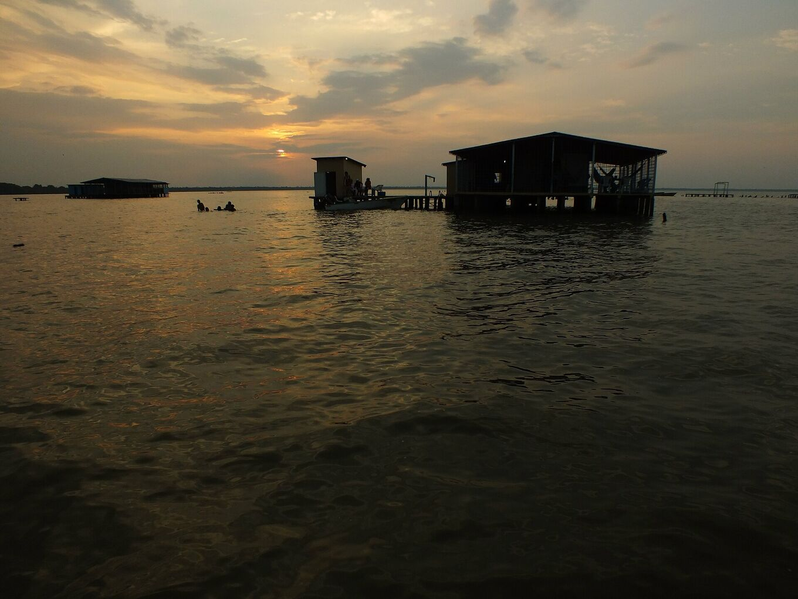
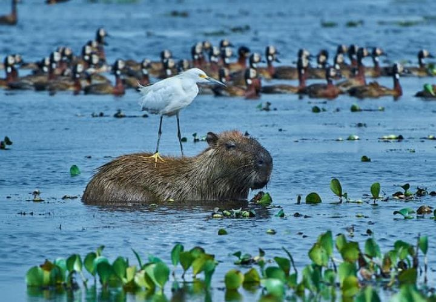

## Dove nasce il temporale

Zone umide, mangrovie e canali nel delta del Catatumbo, a sud-ovest del lago di Maracaibo. È sopra quest'area che il temporale si forma quasi ogni notte. È gestito dall'Istituto nazionale dei parchi (Inparques); le visite si fanno con guide autorizzate.

Si chiama anche Ciénagas de Juan Manuel, o Aguas Blancas e Aguas Negras. Una pianura piatta e allagata tra la Sierra de Perijá e il lago, senza colline né dislivelli, con temperature di 22–32 °C e un'umidità molto alta.

*[Juan Pablo Bottaro · Wikimedia Commons · CC BY-SA 4.0](https://commons.wikimedia.org/wiki/File:Lago_en_llamas.jpg)*

| Cifra | Che cosa significa |
| --- | --- |
| 1991 | Anno in cui è diventato parco nazionale |
| ≈ 2.260 km² | Superficie, in due settori |
| 212 | Specie di uccelli registrate |
| 22–32 °C | Temperatura abituale |
| 2 m | Quanto può salire l'acqua nella stagione delle piogge |

## Fiumi e lagune

Il parco occupa la pianura del delta, appena sopra il livello del lago. Lo attraversano fiumi di acque bianche, torbide per i sedimenti che scendono dalle montagne, tra cui il Catatumbo, il Bravo e il Santa Ana. Tra l'uno e l'altro ci sono lagune di acque nere, scure per la materia vegetale, come La Estrella, El Congo e Ologá.

Nella stagione delle piogge l'acqua sale fino a due metri e la pianura si allaga. Gran parte del parco è prateria palustre. Sulle rive crescono mangrovie rosse e foreste allagate con palme, e lungo il Catatumbo restano foreste ripariali.

Accanto al parco c'è una seconda area protetta, la Riserva faunistica Ciénagas de Juan Manuel, Aguas Blancas y Aguas Negras. Entrambe sono elencate come Aree chiave per la biodiversità.

## Fauna

### Uccelli

Nel parco sono state registrate 212 specie di uccelli. Dalla barca si vedono aironi bianchi maggiori, aironi azzurri minori, jabirù, anatre, gabbiani, sterne e caracara. Cerca anche il chajà settentrionale (*Chauna chavaria*), un grande uccello di palude che vive solo nei bacini del lago di Maracaibo e del río Magdalena, e il chajà cornuto (*Anhima cornuta*).

### In acqua

Nei canali e nelle lagune vivono il lamantino (*Trichechus manatus*) e il coccodrillo americano (*Crocodylus acutus*), due specie minacciate. Vicino alla foce del Catatumbo si vedono delfini della Guyana (*Sotalia guianensis*). Ci sono anche caimani dagli occhiali, iguane e lontre di fiume.

### Sulla riva

Sulle rive si vedono i capibara, il roditore più grande del mondo, e tra gli alberi si sentono le scimmie urlatrici. Gli inventari faunistici citano anche il giaguaro, l'ocelot e la lontra gigante. Sono difficili da vedere, quindi non contare di incontrarli.

## Minacce

Le fuoriuscite di petrolio che arrivano a riva sono la minaccia più grave. Si aggiungono il taglio di alberi per costruire e per aprire pascoli, gli incendi, le dighe che cambiano il drenaggio naturale e la caccia illegale. Parte del turismo nel parco non è regolamentata, quindi scegli operatori che rispettino le regole del parco.

## Visitare il parco

Si entra in barca da Puerto Concha, vicino a Santa Bárbara del Zulia. Il percorso segue i canali e le mangrovie del parco ed esce sul lago verso Ologá. La maggior parte delle escursioni al fulmine lo attraversa già.

- Vai sempre con una guida autorizzata e indossa il giubbotto di salvataggio a ogni tragitto.
- Porta via i tuoi rifiuti, perché sull'acqua non c'è dove lasciarli.
- Non accendere fuochi. Gli incendi sono una delle minacce del parco.
- Non dare da mangiare agli animali e non inseguirli. Tieni le distanze da lamantini e coccodrilli.
- Non comprare animali selvatici né prodotti ricavati da essi.

## Fonti

Superficie e specie secondo Inparques (1996), riportate da Key Biodiversity Areas. Altre fonti danno cifre leggermente diverse.

- [Wikipedia · Ciénagas del Catatumbo National Park](https://en.wikipedia.org/wiki/Ci%C3%A9nagas_del_Catatumbo_National_Park)
- [Key Biodiversity Areas · Parque Nacional Ciénagas de Juan Manuel](https://www.keybiodiversityareas.org/site/factsheet/14955)
- [Key Biodiversity Areas · Reserva de Fauna Silvestre Ciénagas de Juan Manuel](https://www.keybiodiversityareas.org/site/factsheet/14956)
- [IMMA · Maracaibo Lake System](https://www.marinemammalhabitat.org/wp-content/uploads/imma-factsheets/NorthWestAtlanticOceanWiderCaribbean/Maracaibo-Lake-System-NorthWestAtlanticOceanWiderCaribbean.pdf)
