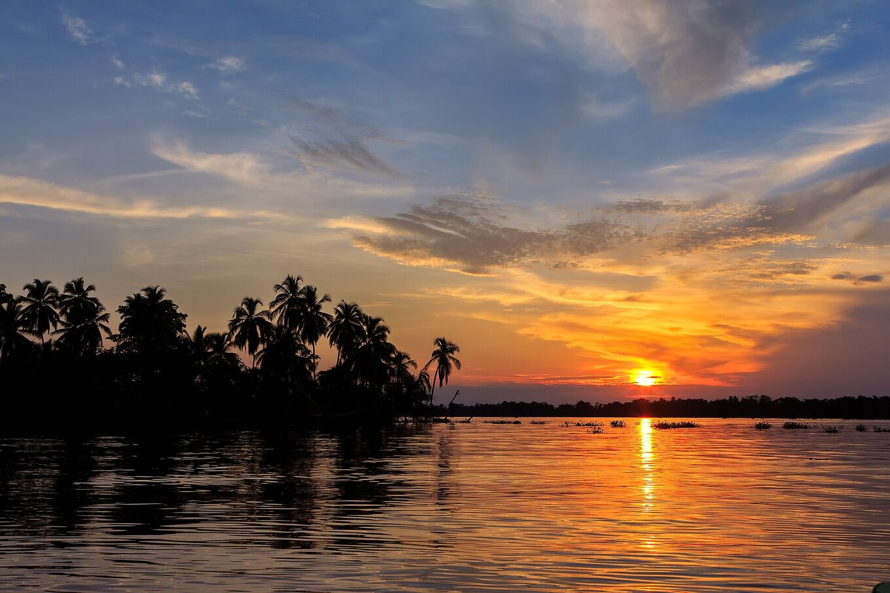
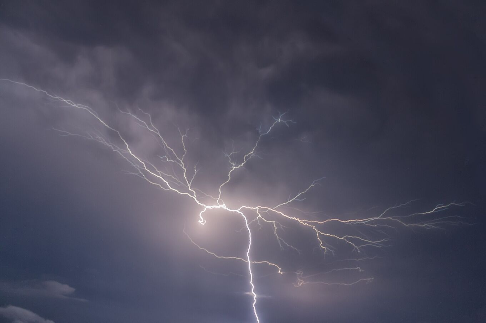

## Quando andare

Il temporale comincia al tramonto e di solito dura fino alle prime ore del mattino. Da settembre a novembre sono i mesi più attivi. Controlla le previsioni meteo il pomeriggio dell'escursione.

Aprile e maggio portano un secondo picco, più piccolo. Gennaio e febbraio sono i mesi più tranquilli, con meno temporali ma giornate più asciutte e acqua più calma. Arriva prima del tramonto, perché anche il crepuscolo sul lago fa parte dello spettacolo.

Passi da Maracaibo a novembre? La Feria de la Chinita, dall'11 al 18 novembre, riempie la città di gaitas, processioni e gente.

*[Fernando Flores · Wikimedia Commons · CC BY-SA 2.0](https://commons.wikimedia.org/wiki/File:Sunset_at_Congo_Mirador_%2823978940929%29.jpg)*

## L'anno del fulmine

Il ritmo segue le piogge. La fascia delle piogge tropicali si sposta a nord e a sud durante l'anno e porta due stagioni più umide, una prima ad aprile e maggio, e una più forte nella seconda metà dell'anno, con il picco tra settembre e ottobre. Fenomeni climatici come El Niño la spostano da un anno all'altro. La siccità che spense il fulmine da gennaio a marzo 2010 era legata a El Niño.

Nel corso di una notte, l'attività di solito comincia al tramonto, cresce dopo il buio ed è più forte verso mezzanotte e nelle prime ore del mattino. Nei mesi più secchi può presentarsi come temporale secco, senza pioggia.

*[Fernando Flores · Wikimedia Commons · CC BY-SA 2.0](https://commons.wikimedia.org/wiki/File:Catatumbo_Lightning_-_Rayo_del_Catatumbo_%2822668686290%29.jpg)*
