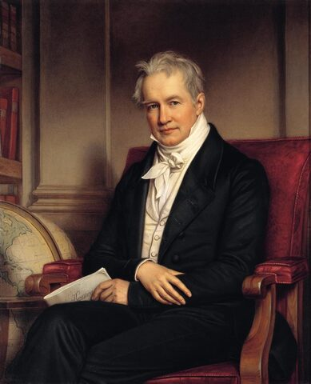
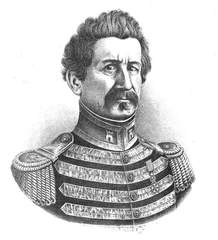
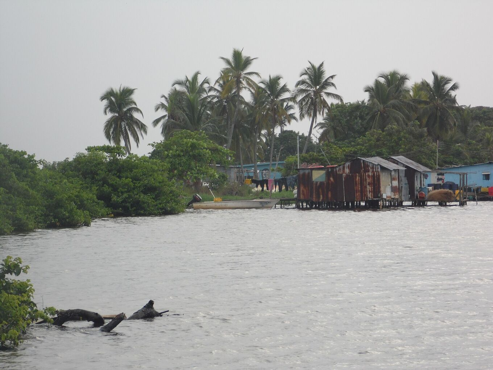
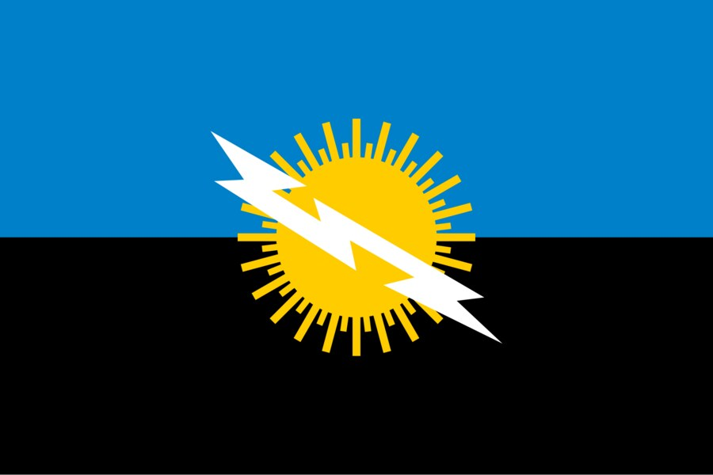

## Quattro secoli guardando a sud.

Navigatori, viaggiatori e scienziati hanno lasciato traccia del bagliore del sud del lago. Questa è una breve cronologia di ciò che è documentato.

### 1822 · Il faro di Maracaibo

Alexander Walker raccoglie i nomi con cui lo chiamavano i navigatori: «Faro di Maracaibo» e «Lanterne di sant’Antonio». Il bagliore serviva da riferimento per orientarsi di notte nel golfo e sul lago.

### 1826 · Humboldt

Alexander von Humboldt descrive il fenomeno nel suo racconto di viaggio, a partire dai resoconti di M. Palacios. È una delle prime descrizioni a circolare in Europa.

Lo chiama «esplosioni elettriche che sono come bagliori fosforescenti», sulla base del libro di Palacios *Viage de Varinas*.

*[Joseph Karl Stieler · Wikimedia Commons · Pubblico dominio](https://commons.wikimedia.org/wiki/File:Stieler,_Joseph_Karl_-_Alexander_von_Humboldt_-_1843.jpg)*

### 1841 · «Come un lampo continuo»

Il geografo Agustín Codazzi lo descrive come «un lampo continuo» visibile da lontano sopra il río Catatumbo. La sua opera fissa il fenomeno nella cartografia del Venezuela.

Aggiunge che la sua posizione, quasi sul meridiano della bocca del lago, guida i navigatori come un faro.

*[Wikimedia Commons · Pubblico dominio](https://commons.wikimedia.org/wiki/File:Retrato_Agust%C3%ADn_Codazzi.jpg)*

### 1966–1970 · Le prime spedizioni

Lo scienziato Andrés Zavrotsky e un gruppo dell’Università delle Ande compiono tre spedizioni a Santa Bárbara del Zulia. Collocano i centri del temporale nelle paludi di Juan Manuel, a ovest del lago.

### 1997–2000 · L’ipotesi del metano

Un gruppo dell’Università di Carabobo guidato da Nelson Falcón raggiunge il cuore delle paludi e propone il metano come una delle cause principali. Nessuna misura ha finora confermato la presenza di metano nelle nubi temporalesche.

### 2005 · Patrimonio naturale

Lo Stato di Zulia dichiara il fulmine suo patrimonio naturale il 27 settembre 2005. C’è chi chiede ancora per la zona il riconoscimento di Patrimonio dell’umanità dell’UNESCO.

### 2010 · Il silenzio

Da gennaio a marzo 2010 il fulmine smise di vedersi, a quanto pare per una forte siccità. Si ipotizzò che fosse scomparso per sempre; l’attività tornò con le piogge.

### 2014 · Un record Guinness

Il 28 gennaio 2014, giorno dello Zulia, il Guinness World Records riconosce la zona come il luogo con più fulmini per chilometro quadrato all’anno.

### 2016 · Il punto più ricco di fulmini del pianeta

Uno studio con i dati del sensore LIS della NASA (Albrecht et al., 2016) mette il lago di Maracaibo al primo posto al mondo, con circa 232,5 lampi per km² all’anno. In precedenza il Guinness lo aveva registrato come la maggiore concentrazione di fulmini.

Nello stesso anno, un gruppo dell’Università dello Zulia pubblica la prima previsione stagionale dei fulmini, basata sul vento notturno del lago.

### 2018 · Villaggi che si spostano

L’interramento circonda di terra le palafitte di Congo Mirador. La maggior parte degli abitanti se ne va e diverse case vengono rimorchiate in barca fino a Ologá, che diventa la base dei visitatori.

*[Yoser Linares · Wikimedia Commons · CC BY-SA 4.0](https://commons.wikimedia.org/wiki/File:Comunidad_de_Olog%C3%A1.jpg)*

## La casa del tuono.

Nella lingua barí, Catatumbo si traduce come «casa del tuono». Un racconto attribuito al popolo barí dice che le luci del cielo sono cocuyos, lucciole, che si riuniscono ogni notte per rendere omaggio a Sabaseba, il creatore che mise in ordine il mondo. È un racconto, non una spiegazione meteorologica.

I barí vivono nel bacino del Catatumbo, su entrambi i lati del confine tra Venezuela e Colombia. Per secoli hanno resistito alle spedizioni spagnole. Da allora il loro territorio si è ridotto, sotto la pressione dei coloni e delle trivellazioni petrolifere.

## Altri racconti del lago.

### Le lucciole di Sabaseba

*Racconto barí*

Le luci del cielo sarebbero milioni di lucciole riunite sopra il lago per onorare il creatore. Si narra come racconto del popolo barí, che vive nel bacino del Catatumbo.

### Un segno della natura

*Tradizione wayuu*

Per il popolo wayuu, il fulmine è un segno della natura che chiede rispetto e dà forza. Il fulmine compare anche sulla bandiera e sullo stemma dello Stato di Zulia.

Racconti wayuu e yukpa vi vedono anche gli spiriti dei wayuu caduti, che brillano nel cielo come un messaggio.

*[Wikimedia Commons · Pubblico dominio](https://commons.wikimedia.org/wiki/File:Flag_of_Zulia_State.svg)*

### Drake e la notte illuminata

*Leggenda · smentita dai documenti*

Si ripete che nel 1595 il fulmine tradì la flotta di Francis Drake davanti a Maracaibo, e che Lope de Vega lo cantò ne «La Dragontea». Quel bagliore veniva invece da navi in fiamme a San Juan di Porto Rico.

### La battaglia del lago

*Racconto popolare*

Un racconto diffuso dice che nella battaglia navale del lago di Maracaibo, nel 1823, i fulmini mostrarono alla flotta patriota la posizione delle navi realiste. È memoria popolare, non un fatto documentato.

La battaglia invece è documentata: il 24 luglio 1823 la flotta di José Prudencio Padilla sconfisse la squadra spagnola e consolidò l’indipendenza del Venezuela e della Nuova Granada. Entrambi i Paesi celebrano ancora quella data come giorno della Marina.

### Nelle canzoni

Il fulmine compare nell’inno dello Stato di Zulia, di Udón Pérez, e in molte gaitas, la musica dello Zulia.

> Questi racconti sono raccolti come memoria culturale, con la loro fonte quando è nota. Dove un racconto contraddice i documenti, lo diciamo.
