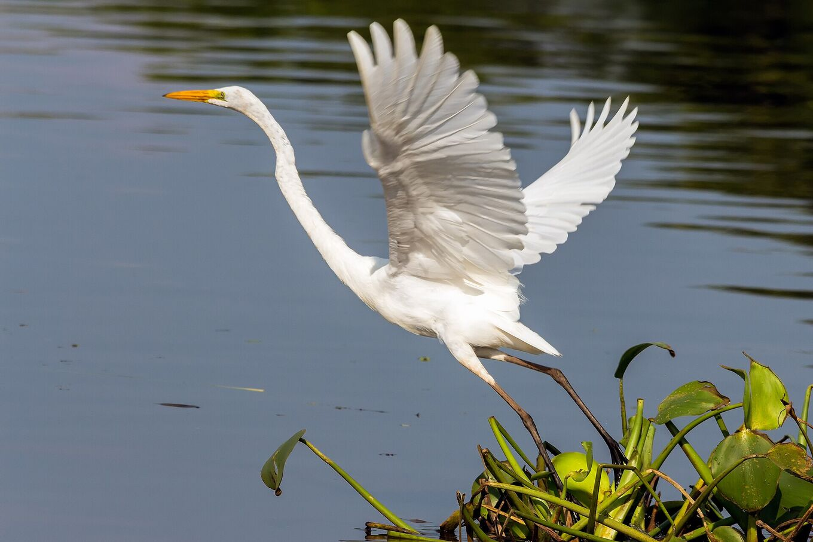

## Rispetto

A Ologá e a Congo Mirador vive gente. Chiedi il permesso prima di fotografare le persone, scegli servizi locali e porta via i tuoi rifiuti. Rispetta le regole d'uso del parco nazionale.

Le famiglie delle palafitte vivono di pesca e di visitatori. Compra i loro pasti e il loro artigianato. Di notte fai silenzio. Chiedi prima di far volare un drone. Non dare da mangiare agli animali e non inseguirli.

*[Fernando Flores · Wikimedia Commons · CC BY-SA 2.0](https://commons.wikimedia.org/wiki/File:Great_Egret_Garza_Real_%28Ardea_alba_egretta%29_%2824754473973%29.jpg)*

## Scegli servizi locali

Ingaggiare guide, barcaioli e alloggi della zona lascia il denaro nelle comunità che vivono accanto al fulmine.

Chiedi se i barcaioli e chi cucina vengono da Ologá o dai villaggi vicini. Mangia quello che cucinano le famiglie e lascia una mancia a guide e barcaioli se il servizio è stato buono.

## Progetti nei villaggi

Un progetto di agriturismo, «Al fulmine del Catatumbo, lungo il fiume Catatumbo», punta a migliorare la vita a Ologá e Congo Mirador con la [Fondazione Finnova](https://www.finnova.com/). Tra i suoi obiettivi:

- Pannelli solari sulle palafitte per sostituire il 90 % dei generatori a benzina.
- Biodigestori e zone umide artificiali per trattare le acque reflue.
- Ristrutturare 25 palafitte in ogni villaggio.
- Barche a basso pescaggio e silenziose, e un centro di riciclo basato sul principio «rifiuti zero».
- Formare 100 abitanti come guide, con l'INATUR, e lasciare nei villaggi almeno il 30 % della spesa dei visitatori.
- Una stazione biologica, con l'UNESUR, per studiare il cambiamento climatico, l'insabbiamento del Catatumbo e l'inquinamento.

È stata annunciata anche una barca ambulanza per i due villaggi, della Fundación Azul Ambientalistas e di Venemergencia, con trasferimenti d'urgenza e telemedicina.

Puoi aiutare già da ora. Separa i tuoi rifiuti e riportali sulla terraferma, perché sulle palafitte non c'è raccolta.
