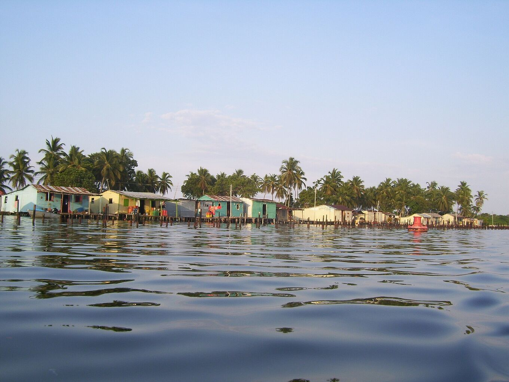
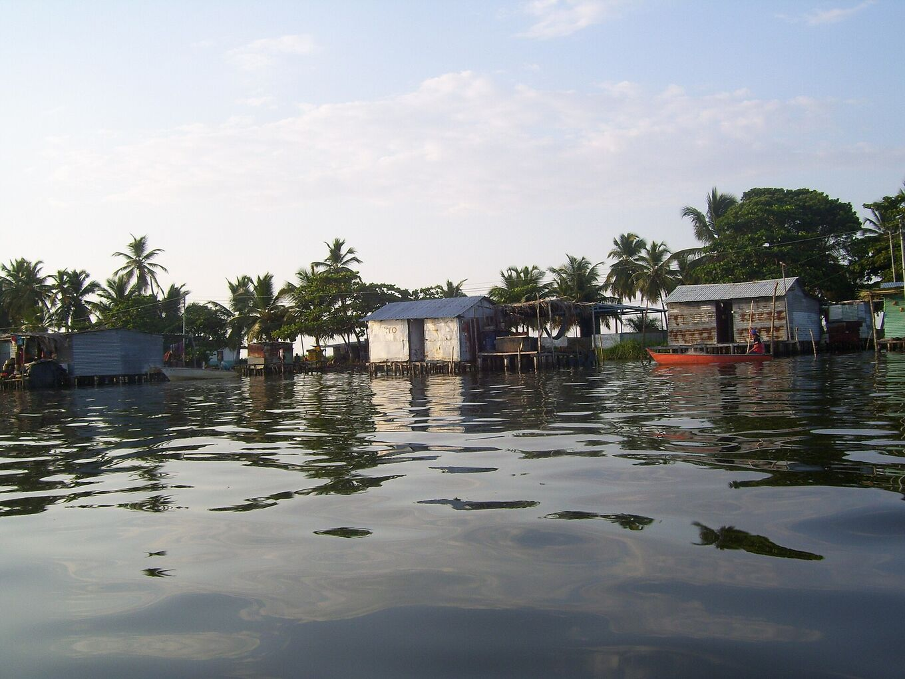
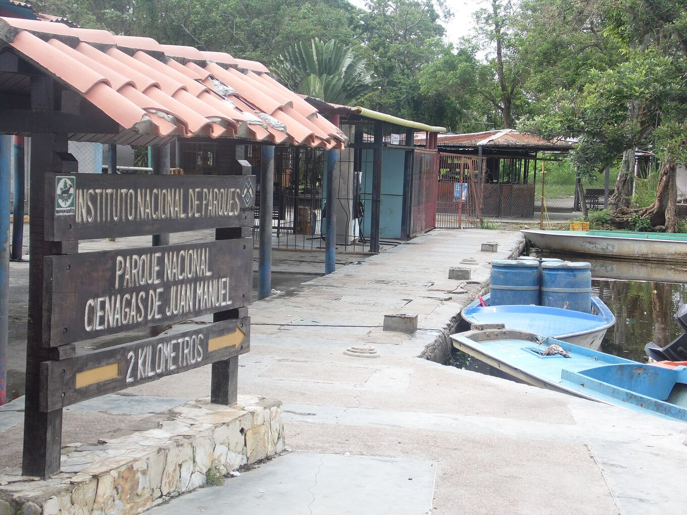
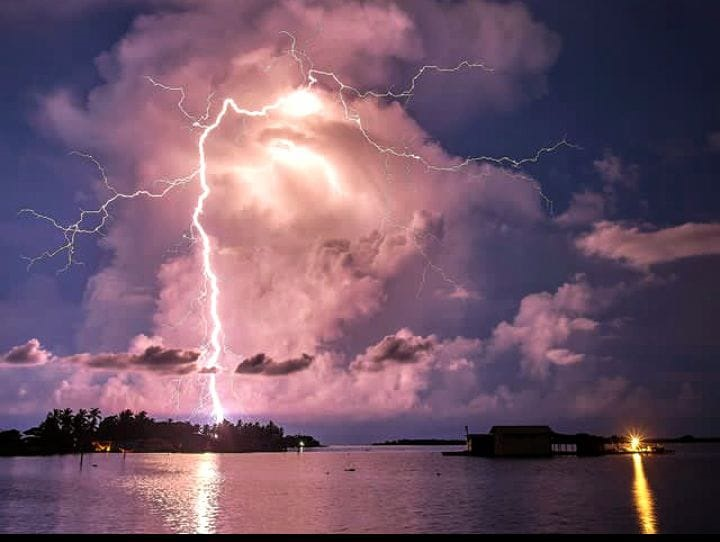

## Il lago di Maracaibo

I villaggi su palafitte da cui si osserva il temporale e l'imbarcadero da cui partono le barche. L'area protetta dove nasce il temporale, il parco nazionale Ciénagas del Catatumbo, ha una pagina tutta sua.

Il lago di Maracaibo copre circa 13.500 km². A nord comunica con il mar dei Caraibi attraverso uno stretto, a sud lo alimentano decine di fiumi. Il più grande, il Catatumbo, porta più della metà della sua acqua.

Vivere sull'acqua qui è una tradizione antica. Gli añú, popolo indigeno del lago, costruivano già palafitte quando arrivarono gli spagnoli nel 1499.

## Il sud del lago

### Ologá

*Comunità del lago · palafitte*

Villaggio su palafitte a una decina di minuti di barca da Congo Mirador. Oggi è la base principale per osservare il fulmine, con campi e pensioni semplici sopra l'acqua.

Alcune delle sue case vengono da Congo Mirador. Poggiate su pali, si potevano caricare su due barche e spostare fin qui.

*[Yinette Bracho Padilla · Wikimedia Commons · CC BY-SA 4.0](https://commons.wikimedia.org/wiki/File:Palafitos_del_pueblo_de_Olog%C3%A1.jpg)*

### Congo Mirador

*Comunità del lago · palafitte*

Era il villaggio più noto per vedere il fulmine. L'interramento del lago e la crisi economica lo hanno svuotato. Verso il 2018 se n'era andato circa il 90 % degli abitanti e molte case erano state spostate a Ologá. [Wikipedia](https://es.wikipedia.org/wiki/Congo_Mirador)

Il villaggio ha almeno 200 anni e viveva di pesca e, più tardi, di visitatori. Alla fine degli anni Settanta contava circa 930 abitanti, e circa mille nel 2013. Gli abitanti attribuiscono l'interramento a un canale di tre chilometri aperto dal río Bravo nel 1991, il "Caño J". Nel 2021 restavano circa cinque persone. La sua storia è raccontata nel documentario *Once Upon a Time in Venezuela* (2020), di Anabel Rodríguez Ríos.

*[Yinette Bracho Padilla · Wikimedia Commons · CC BY-SA 4.0](https://commons.wikimedia.org/wiki/File:Palafitos_de_Congo_Mirador.jpg)*

### Puerto Concha

*Imbarcadero · punto di partenza*

Imbarcadero vicino a Santa Bárbara del Zulia, da cui partono le barche per Ologá e il delta. Ci si arriva in auto dall'aeroporto di El Vigía.

Santa Bárbara è la città dell'allevamento del sud del lago, nota per il formaggio e i platani. Fai lì scorta di contanti, acqua e provviste, perché sull'acqua non ci sono negozi.

*[Yoser Linares · Wikimedia Commons · CC BY-SA 4.0](https://commons.wikimedia.org/wiki/File:Puerto_Concha.jpg)*

## La vita sull'acqua

Ologá, nella parrocchia di Encontrados del comune di Catatumbo, è uno dei luoghi più isolati del sud del lago. È da qui che il mondo guarda il fulmine, ma i suoi abitanti vivono con pochissimo.

- Non c'è rete di acqua potabile né fognatura. L'acqua dolce arriva in barca dalla terraferma.
- L'elettricità viene da generatori privati che funzionano poche ore, e internet quasi non c'è.
- L'ambulatorio ha poco personale e poche medicine. Un'emergenza richiede un lungo viaggio in barca.
- La pesca artigianale è la principale fonte di sostentamento. Gli intermediari fissano il prezzo del pesce, e la benzina, scarsa e cara, paralizza la pesca.
- I soldi del turismo arrivano a stagioni e restano soprattutto agli operatori di fuori.

Per questo conta ingaggiare barcaioli, guide e cuoche della comunità (vedi Viaggio responsabile).

