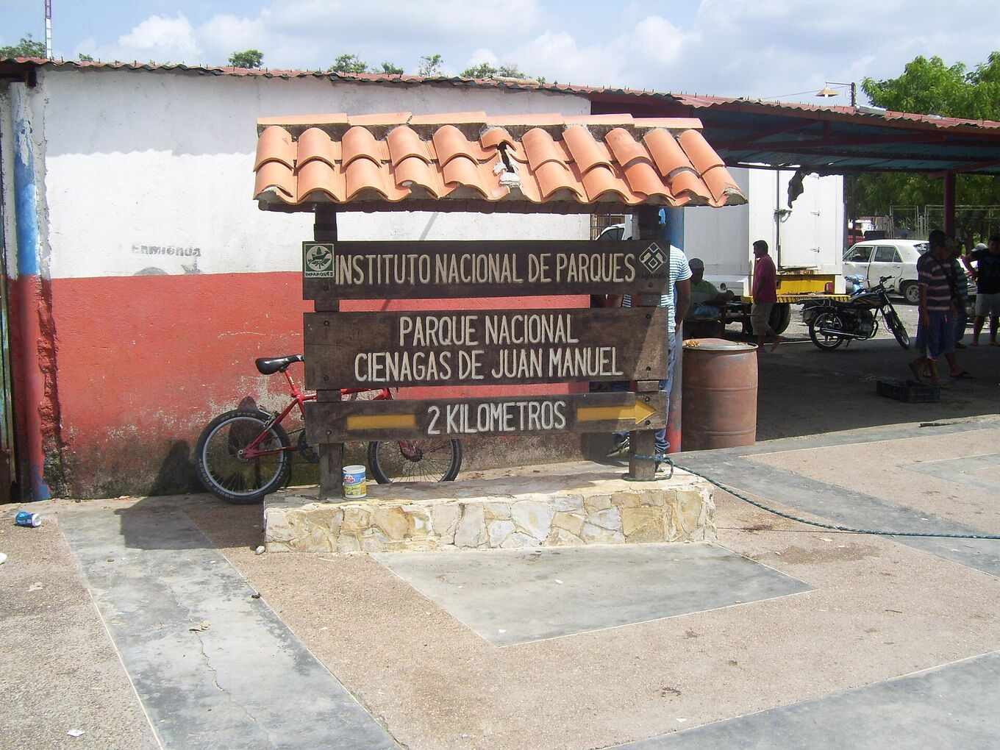
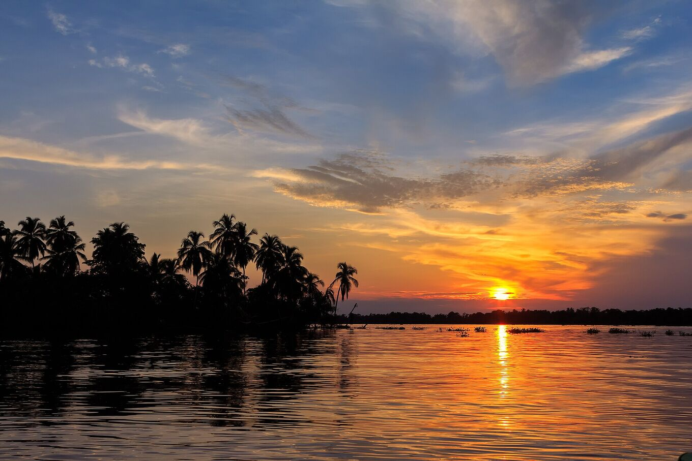
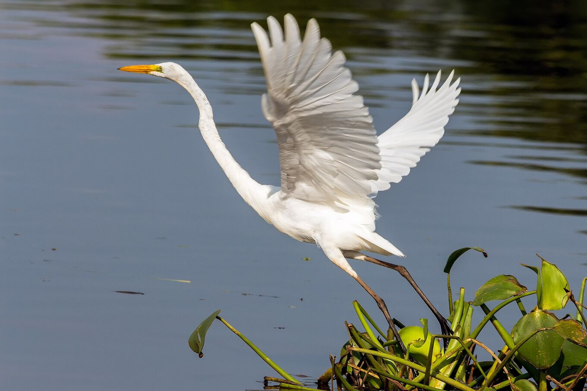

## Prenditi il tuo tempo. Fai attenzione.

### Come arrivare

La maggior parte delle visite parte in barca da Puerto Concha, vicino a Santa Bárbara del Zulia, verso Ologá. L’aeroporto più vicino è El Vigía; Maracaibo è a diverse ore di strada. Molte agenzie organizzano l’escursione da Mérida.

Da Mérida la strada scende dalle Ande verso le pianure del sud del lago, tra piantagioni di platano e allevamenti di bestiame: circa quattro ore fino all’imbarcadero. Da Puerto Concha la barca segue canali e mangrovie fino al parco nazionale ed esce sul lago. Il tragitto dura da una a due ore, secondo il percorso e il livello dell’acqua.

Porta con te il passaporto o un documento: sulle strade ci sono posti di controllo della polizia e dell’esercito.

*[Yinette Bracho Padilla · Wikimedia Commons · CC BY-SA 4.0](https://commons.wikimedia.org/wiki/File:Entrada_al_parque_nacional.jpg)*

### Quando andare

Il temporale comincia al tramonto e di solito dura fino alle prime ore del mattino. Da settembre a novembre sono i mesi più attivi. Controlla le previsioni meteo il pomeriggio dell’escursione.

Aprile e maggio portano un secondo picco, più piccolo. Gennaio e febbraio sono i mesi più tranquilli: meno temporali, ma giornate più asciutte e acqua più calma. Arriva prima del tramonto: anche il crepuscolo sul lago fa parte dello spettacolo.

Passi da Maracaibo a novembre? La Feria de la Chinita, dall’11 al 18 novembre, riempie la città di gaitas, processioni e gente.

*[Fernando Flores · Wikimedia Commons · CC BY-SA 2.0](https://commons.wikimedia.org/wiki/File:Sunset_at_Congo_Mirador_%2823978940929%29.jpg)*

### Cosa portare

Repellente per insetti, maniche lunghe, impermeabile, torcia frontale, contanti, acqua potabile e una sacca stagna per telefono e fotocamera. Nei villaggi su palafitte elettricità e segnale sono limitati.

Inoltre: cappello e crema solare per la barca, vestiti leggeri che asciugano in fretta, una batteria esterna, qualcosa da mangiare e i tuoi farmaci. La corrente arriva di solito da un generatore, e solo per qualche ora.

### Salute

Il sud del lago è caldo e molto umido: 22–32 °C. Bevi spesso. Le zanzare escono al tramonto.

Rivolgiti a un ambulatorio di medicina dei viaggi qualche settimana prima e chiedi del vaccino contro la febbre gialla e della prevenzione della malaria nella zona. Non bere l’acqua del lago e non farci il bagno: alcune parti sono inquinate.

### Sicurezza

I temporali comportano rischi. Segui gli avvisi meteo e le indicazioni delle guide locali. Non navigare sotto il temporale e non ripararti sotto alberi isolati. Emergenze: **VEN 911**.

In acqua aperta una barca è il punto più alto. Se senti il tuono, il temporale è abbastanza vicino da colpirti: lascia l’acqua e mettiti sotto un tetto. Indossa il giubbotto di salvataggio in ogni tragitto.

Consulta gli avvisi di viaggio del tuo Paese prima di prenotare. Diversi Paesi sconsigliano i viaggi in Venezuela o nelle zone vicine al confine con la Colombia. Stipula un’assicurazione di viaggio che li copra.

### Fotografare il fulmine

- **Fotocamera ferma:** un treppiede sulla terrazza della palafitta. Dalla barca le foto vengono mosse.
- **Messa a fuoco:** manuale, all’infinito. L’autofocus non funziona al buio.
- **Esposizione:** 10–30 s, ISO 800–3200, diaframma f/2,8–f/5,6. Scatta in continuo e tieni le migliori.
- **Telefono:** modalità notte, appoggiato a qualcosa di stabile.
- **Luce:** flash spento, torcia in rosso. Anche i tuoi vicini stanno guardando.
- Rimetti la fotocamera nella sacca stagna quando arriva la pioggia.

### Rispetto

Ologá e Congo Mirador sono case, non set fotografici. Chiedi il permesso prima di fotografare le persone, scegli servizi locali e porta via i tuoi rifiuti. Il parco nazionale ha regole d’uso: rispettale.

Le famiglie delle palafitte vivono di pesca e di visitatori. Compra i loro pasti e il loro artigianato. Di notte fai silenzio. Chiedi prima di far volare un drone. Non dare da mangiare agli animali e non inseguirli.

*[Fernando Flores · Wikimedia Commons · CC BY-SA 2.0](https://commons.wikimedia.org/wiki/File:Great_Egret_Garza_Real_%28Ardea_alba_egretta%29_%2824754473973%29.jpg)*

> Trasferimenti, orari e prezzi cambiano con i percorsi, il livello dell’acqua e la disponibilità locale. Confermali con gli operatori della zona prima di partire.

## Fonti e approfondimenti

- [Albrecht et al. · BAMS 2016](https://doi.org/10.1175/BAMS-D-14-00193.1)
- [Muñoz et al. · Atmospheric Research 2016 · previsione stagionale dei fulmini](https://doi.org/10.1016/j.atmosres.2015.12.018)
- [Wikipedia · Relámpago del Catatumbo (spagnolo)](https://es.wikipedia.org/wiki/Rel%C3%A1mpago_del_Catatumbo)
- [Wikipedia · Lago di Maracaibo](https://it.wikipedia.org/wiki/Lago_di_Maracaibo)
- [Wikipedia · Congo Mirador (spagnolo)](https://es.wikipedia.org/wiki/Congo_Mirador)
- [Blitzortung · fulmini in tempo reale](https://www.blitzortung.org/)
